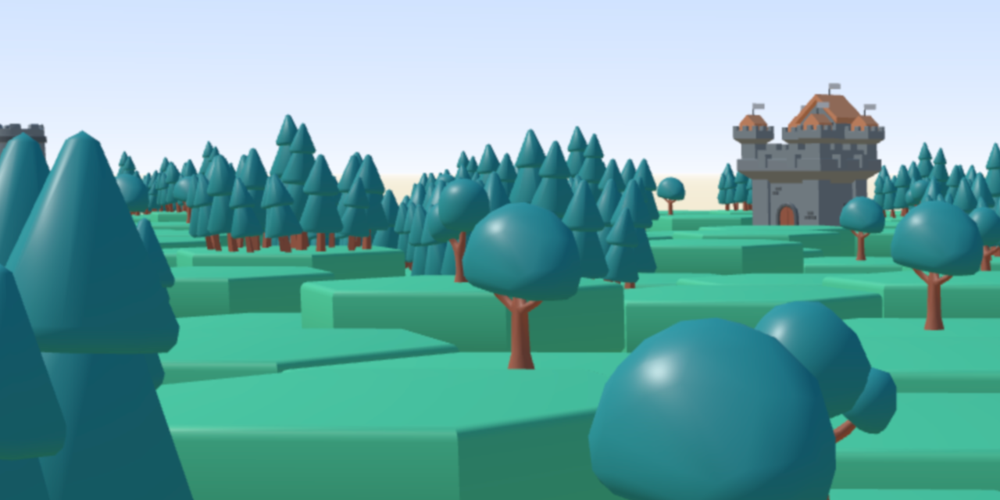

# 3D hex map



A web based 3D take on the hex strategy game Slay. The map lies on a shallow dome, four elephants carry the dome and the elephants stand on a turtle that flies through space.

The game rules run on a plain flat hex grid. The dome only exists in the view: `src/world/dome-projection.ts` projects the grid onto a spherical cap, so the rules never have to care about the curvature.

The project is [deployed on Netlify](https://attkins-hex-map.netlify.app/).

## Getting started

You need Node.js 22.13 or newer (see `.nvmrc`).

```bash
npm install
npm run hooks:install   # once per clone, activates the git hooks
npm run dev
```

## Scripts

| Script               | What it does                                                              |
| -------------------- | ------------------------------------------------------------------------- |
| `npm run dev`        | Starts the Vite dev server                                                |
| `npm run build`      | Type check and production build into `dist/`                              |
| `npm run preview`    | Serves the production build locally                                       |
| `npm run check`      | Lint, format check, type check and tests, the same as the CI              |
| `npm run lint`       | ESLint, `lint:fix` repairs what it can                                    |
| `npm run format`     | Prettier, `format:check` only reports                                     |
| `npm test`           | Vitest once, `test:watch` while developing, `test:coverage` with a report |
| `npm run stats:dome` | Prints how much the projections distort the hexes                         |
| `npm run changelog`  | Regenerates `CHANGELOG.md` from the commits                               |
| `npm run release`    | Bumps the version, updates the changelog, commits, tags and pushes        |

## Dev page keys

| Key         | Action                                         |
| ----------- | ---------------------------------------------- |
| `1` to `3`  | Projection: equidistant, equal area, conformal |
| `+` and `-` | Curvature of the dome                          |
| `L`         | Light direction                                |
| `R`         | New random map                                 |
| `T`         | Tile models or plain colored hexes             |

## Project structure

```
index.html          Dev page with the dome, the world and a random map
src/world/          Hex grid helpers and the projection onto the dome (no three.js)
src/models/         glTF models, `world.glb` is exported from blender/world.blend
src/shaders/        GLSL for the sky dome
blender/            Blender source of the world (turtle, elephants, earth disc)
tools/              Small scripts for experiments
attic/              Earlier experiments, kept for reference, not part of the build
docs/               Ideas, notes and resources
```

## Commits, hooks and releases

Commits follow [Conventional Commits](https://www.conventionalcommits.org) such as `feat: add province income` or `fix(view): align models on the rim`. The commit messages are in English.

`npm run hooks:install` points git to `.githooks/`:

- `pre-commit` runs ESLint and Prettier on the staged files
- `commit-msg` checks the message with commitlint
- `pre-push` runs the type check and the tests

`CHANGELOG.md` is generated from the commit messages with [git-cliff](https://git-cliff.org), configured in `cliff.toml`. Commits that do not follow the convention are left out and edits by hand get lost on the next run. Versions come from git tags, not from `package.json`. A release is one command:

```bash
npm run release          # patch, or release:minor and release:major
```

It refuses to run on a dirty working tree.

## Acknowledgements

The tile models are Kay Lousberg's [Medieval Builder Pack](https://kaylousberg.com).

[](http://www.wtfpl.net/)
[](https://app.netlify.com/sites/attkins-hex-map/deploys)
